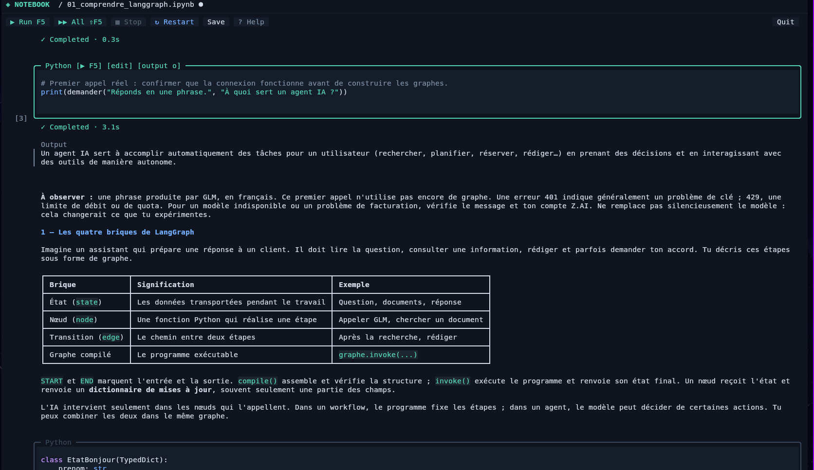

# notebook-tui

A terminal editor for Jupyter notebooks, built with Rust and Ratatui.

## Quickstart

Requires Rust and Python. From this repository:

```sh
cargo install --path . --locked --force
```

Install the Python dependencies in your project's environment:

```sh
python -m pip install jupyter-client ipykernel
```

## Run

```sh
cd /path/to/notebooks
notebook-tui my_notebook.ipynb
```

The project's `.venv` is detected automatically. Use `--python /path/to/python` to select another interpreter.

- **↑ / ↓**: select a cell · **Enter / Esc**: edit / navigate
- **F5 / Shift+F5**: run cell / run all · **Ctrl+C**: stop execution
- **Ctrl+S**: save · **Ctrl+Q** or **Quit**: exit
- **Ctrl+B**: toggle files · **?**: help

Cells show a live timer while running, ✓ on success, × on error, and ■ when interrupted. Timings are kept for the current session.
